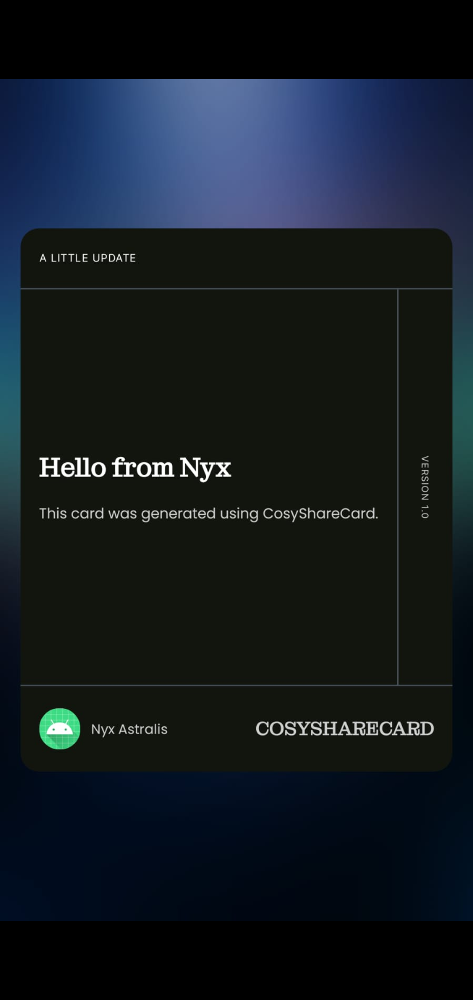
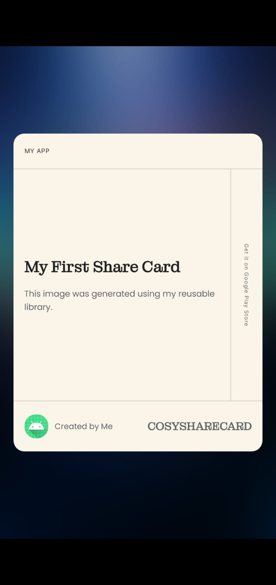
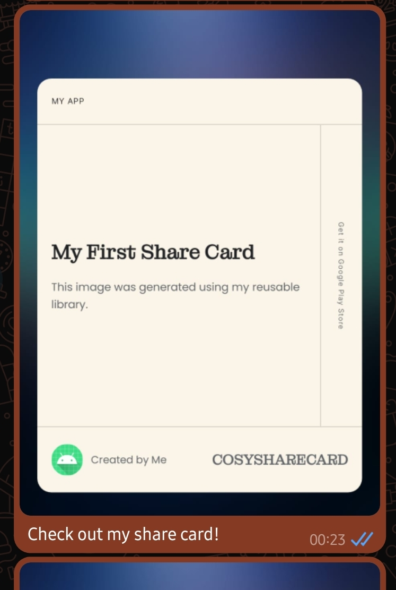
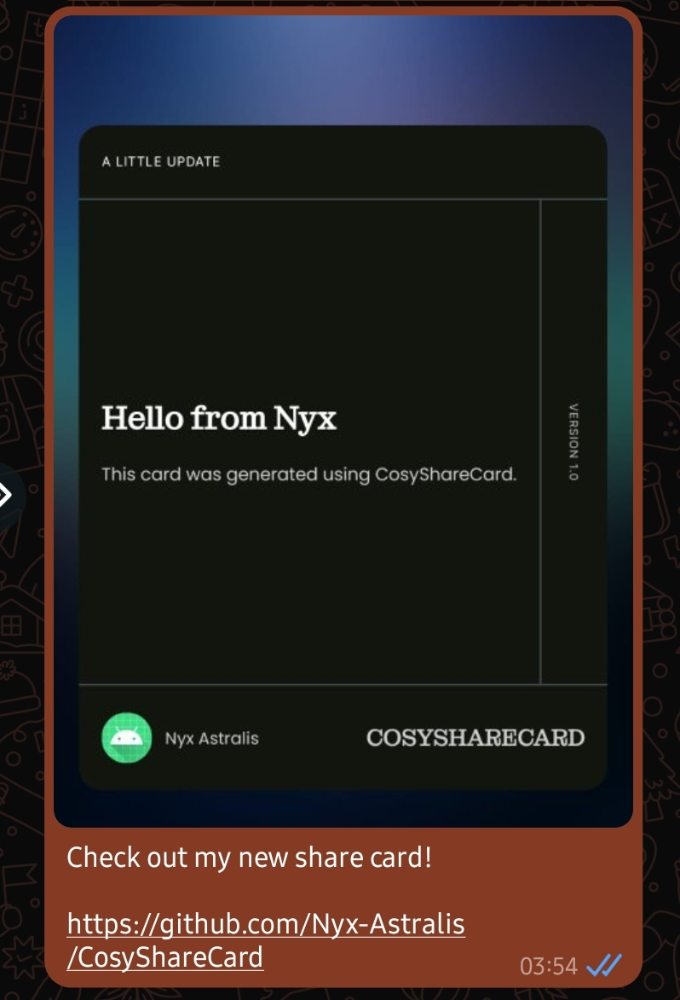

# CosyShareCard

**Create and share polished image cards from your Android app.**

CosyShareCard is a reusable Android library written in Java. It renders a branded card as a PNG image and opens Android's system share chooser so users can send the image through compatible apps.

[](https://jitpack.io/#Nyx-Astralis/CosyShareCard)
[](https://github.com/Nyx-Astralis/CosyShareCard/releases/tag/1.0.0)
[](https://developer.android.com/about/versions/oreo)
[](LICENSE)

## Features

- Generate a PNG share card from a small Java builder API.
- Add a header, title, description, side label, author name, and brand label.
- Automatically include the consuming app's launcher icon.
- Choose light, dark, or automatic theme colors.
- Adjust or disable the background blur.
- Attach optional share text and a link to the Android share intent.
- Share through Android's `ACTION_SEND` chooser using a `FileProvider` content URI.
- Keep generated images in the app's internal cache; no public-storage permission is required.

## Screenshots

<p align="center">
  
  
</p>

<p align="center">
  
  
</p>

## Requirements

- Android `minSdk` 26 (Android 8.0) or higher.
- An Android project compiling against Android SDK 37 or higher.
- Java 11-compatible Android build configuration.
- Android Gradle Plugin / Gradle versions compatible with the consuming project.

The library is implemented in Java and can also be called from Kotlin projects.

## Installation

CosyShareCard is published through [JitPack](https://jitpack.io/#Nyx-Astralis/CosyShareCard).

### 1. Add the JitPack repository

If your project centralizes dependency repositories in `settings.gradle.kts`, add JitPack inside `dependencyResolutionManagement.repositories`:

```kotlin
dependencyResolutionManagement {
    repositoriesMode.set(RepositoriesMode.FAIL_ON_PROJECT_REPOS)
    repositories {
        google()
        mavenCentral()
        maven { url = uri("https://jitpack.io") }
    }
}
```

Keep any other repositories already used by your project. Add the `maven` entry only once.

### 2. Add the dependency

In the app module's `build.gradle.kts`:

```kotlin
dependencies {
    implementation("com.github.Nyx-Astralis:CosyShareCard:1.0.0")
}
```

For Groovy Gradle (`build.gradle`):

```groovy
dependencies {
    implementation 'com.github.Nyx-Astralis:CosyShareCard:1.0.0'
}
```

Sync Gradle after adding the dependency.

## Quick start (Java)

Create a builder, configure the text and theme, create the share intent, and launch it from an `Activity`:

```java
import android.content.Intent;
import android.widget.Toast;

import com.studio868.cosysharecard.CosyShareCard;
import com.studio868.cosysharecard.CosyShareCardBuilder;
import com.studio868.cosysharecard.CosyShareCardTheme;

import java.io.IOException;

// Call this from an Activity, for example from a button click.
private void shareDemoCard() {
    CosyShareCardBuilder builder = new CosyShareCardBuilder(this)
        .setHeader("A LITTLE UPDATE")
        .setTitle("Hello from Nyx")
        .setDescription("This card was generated using CosyShareCard.")
        .setSideText("VERSION 1.0")
        .setAuthor("Nyx Astralis")
        .setBrand("CosyShareCard")
        .setShareText("Check out my new share card!")
        .setShareLink("https://github.com/Nyx-Astralis/CosyShareCard")
        .setTheme(CosyShareCardTheme.AUTO);

    try {
        Intent shareIntent = CosyShareCard.createShareIntent(builder);
        startActivity(shareIntent);
    } catch (IOException e) {
        Toast.makeText(
            this,
            "Unable to create share card: " + e.getMessage(),
            Toast.LENGTH_LONG
        ).show();
    }
}
```

`createShareIntent()` returns an `Intent`; it does not launch the chooser itself. Call `startActivity()` with the returned intent.

## Builder options

All text values are optional. A field that is not set is rendered as empty text.

| Method | Purpose |
| --- | --- |
| `setHeader(String)` | Small header at the top of the card. |
| `setTitle(String)` | Main card title. The fixed layout displays up to three lines. |
| `setDescription(String)` | Supporting description. The fixed layout displays up to four lines. |
| `setSideText(String)` | Rotated label along the right side of the card. |
| `setAuthor(String)` | Author text in the footer. |
| `setBrand(String)` | Brand text in the footer. |
| `setShareText(String)` | Optional text added to the share message; not printed on the image. |
| `setShareLink(String)` | Optional link appended to the share message; not printed on the image. |
| `setTheme(CosyShareCardTheme)` | Selects `AUTO`, `LIGHT`, or `DARK`. |
| `setBlurRadius(float)` | Sets backdrop blur radius in dp. Defaults to `28f`; use `0f` to disable blur. |

Example theme selection:

```java
builder.setTheme(CosyShareCardTheme.LIGHT); // Always light
builder.setTheme(CosyShareCardTheme.DARK);  // Always dark
builder.setTheme(CosyShareCardTheme.AUTO);  // Follows the device/app night mode
```

## How sharing works

1. The library inflates its bundled card layout and fills in the builder values.
2. It uses the consuming app's launcher icon in the footer.
3. It renders the composition into a 16:9 PNG bitmap.
4. It writes the PNG to the app's internal cache directory (`cache/shared_images/`).
5. It creates a read-granted `content://` URI using the library's merged `FileProvider` declaration and returns an Android share chooser intent.

The library manifest supplies a provider authority based on the consuming app's application ID. In a normal Android Gradle setup, the manifest merger adds it automatically; you should not need to declare a second provider yourself. The library does not require the app to request public/external storage permission.

Generated images are cached rather than saved to the user's public gallery. Android may clear cache files when it needs storage space.

## Current design scope

Version 1.0.0 exposes text, theme, and blur configuration. The background artwork and card layout are bundled resources; this version does not expose a public API for supplying a custom background image, changing individual colors, or rearranging the card layout. The app icon is read automatically from the consuming application's launcher icon.

## Important notes

- Call `createShareIntent()` on the Android main/UI thread because rendering uses Android Views.
- Handle the declared `IOException`, which can occur if the cache directory cannot be created or the PNG cannot be written.
- A null context, null builder, null theme, or negative blur radius is invalid and can cause `IllegalArgumentException`.
- `setBlurRadius(0f)` disables the backdrop blur. Negative values are rejected.
- `setShareText()` and `setShareLink()` contribute to `Intent.EXTRA_TEXT`; they do not appear inside the rendered PNG.

## Documentation

See [`docs/USAGE.md`](docs/USAGE.md) for a fuller integration walkthrough, API details, and troubleshooting.

## ☕ Support the Project

Enjoying **CosyShareCard**? Your support helps me maintain the library, develop new features, and continue creating open-source tools.

Every contribution is greatly appreciated!

<p align="center">
  <a href="https://ko-fi.com/nyx_astralis">
    
  </a>
</p>

<p align="center">
  Thank you for supporting independent development! ❤️
</p>


## License

The original CosyShareCard library code is licensed under the MIT License. See [`LICENSE`](LICENSE).

The library also bundles third-party typefaces and depends on Android libraries with their own licenses. See [`THIRD_PARTY_NOTICES.md`](THIRD_PARTY_NOTICES.md). The MIT license does not replace or override those third-party terms.

## Project links

- Source: <https://github.com/Nyx-Astralis/CosyShareCard>
- JitPack: <https://jitpack.io/#Nyx-Astralis/CosyShareCard>
- Issues: <https://github.com/Nyx-Astralis/CosyShareCard/issues>
